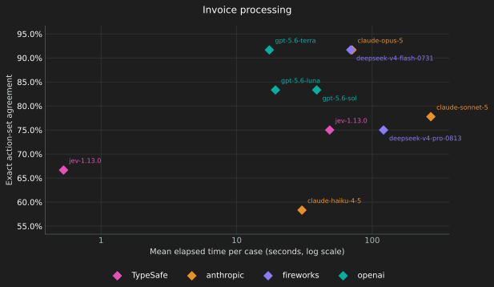
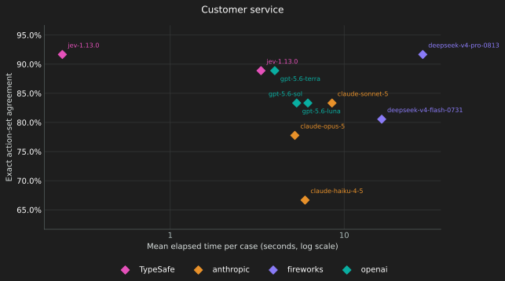
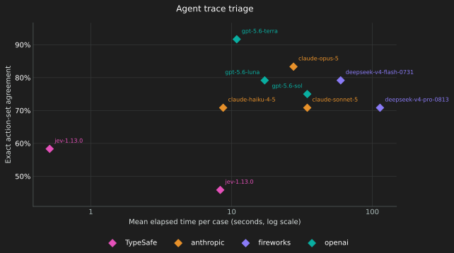
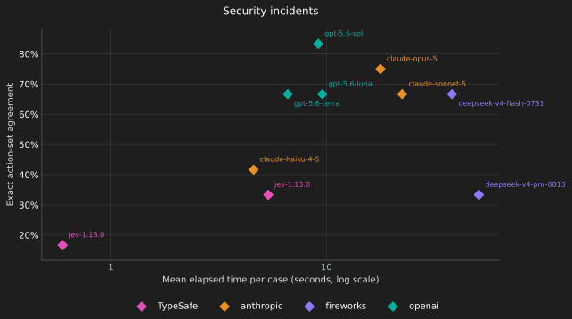

# WorkflowEvals: e-jev against Jev

TypeSafe's own benchmark ([WorkflowEvals](https://github.com/typesafe-ai/WorkflowEvals), pinned at
`0ac3b8a`), run against e-jev through its `--base-url` override and scored with its own code against the
runs TypeSafe publishes on Hugging Face — Jev 1.13 and eight LLMs — on the same cases.

- **e-jev** `cyankiwi/Qwen3.6-27B-AWQ-INT4` on one RTX 4090, vLLM 0.30.0.
- **Sample** the first 12 cases of each workflow (48 of 705). Agreement with the consensus reference label.
- **Reproduce** `make evals` (`EVALS_LIMIT=12` by default).

| Workflow | Metric | v1 | v2 | Jev 1.13 | best LLM | v1 s/case | v2 s/case | Jev s/case |
|---|---|---|---|---|---|---|---|---|
| invoice_processing | exact actions | 0.750 | 0.694 | 0.667 | 0.917 | 48.6 | **32.0** | 0.53 |
| customer_service | exact actions | 0.889 | 0.889 | 0.917 | 0.917 | 3.3 | 3.3 | 0.24 |
| agent_trace_observability | primary action | 0.458 | 0.458 | 0.583 | 0.917 | 8.3 | **7.4** | 0.51 |
| security_incidents | exact actions | 0.333 | 0.250 | 0.167 | 0.833 | 5.4 | **2.4** | 0.60 |
| mean | | 0.608 | 0.573 | 0.583 | | | | |

- **v1** (2026-10-01): fp32 recurrent state, uncalibrated.
- **v2** (2026-10-01): bf16 recurrent state, per-kind temperatures fitted on BoolQ / AG News / Banking77 / SST-5.

## Reading it

- **Quality: on par with Jev, iteration to iteration and against it.** Every workflow differs by at most one
  or two cases out of twelve, in both directions; at n = 12 that is noise, not a ranking. Both e-jev and
  Jev trail the best LLMs, which reason over the whole case — the price of a decision model.
- **What moved between v1 and v2, traced to its cause.** invoice_processing lost one case to bf16: a noul at
  p = 0.52 crossed to 0.44 (measured drift vs fp32: mean |Δp| 0.0009, p95 0.0066). security_incidents
  compares probabilities with thresholds; the BoolQ-fitted temperature (2.46) pulls them toward 0.5
  (0.879 → 0.692) and moved seven decisions — three better, two worse, two still wrong. Calibration is
  fitted to the data it saw; thresholds tuned to Jev's calibration move with it.
- **Speed: v2 is 11–56 % faster than v1, still 10–60× slower than Jev.** Prefill runs at ~2,450 tokens/s,
  which is this 27B's compute ceiling on a 4090 (≈135 TFLOPs); the prefix cache already serves 87 % of the
  tokens. What remains is each question's own tokens. Jev runs on TypeSafe's cluster.
- **Cost**: usage counts the state once per request, as TypeSafe bills; the harness's estimates use Jev's
  price list and are meaningless for a local GPU.

Agreement against time per case, published runs and e-jev's:

## Decision backends

Bake-off (2026-10-13/14) of trained decision models against the logprob reader, all through the
System One contract, all measured on this 4090 machine. Raw results: `.reports/2026-10-13_backends/`
(one JSON per run + `watch_*.json` peaks + `windows.md` of every vLLM stop/start window); the table
and the plot below regenerate with `uv run --with matplotlib python scripts/backends_report.py
.reports/2026-10-13_backends`.

**Harnesses.** Held-out halves of BoolQ / AG News / Banking77 / SST-5 plus a new Spanish set — MASSIVE
`es-ES` intents (60-way and the 20-option form Laya measures; `AmazonScience/massive@ff6bd8e`, tarball
1.0), `cardiffnlp/tweet_sentiment_multilingual` spanish (score; MASSIVE 1.0 ships no sentiment) and
`facebook/xnli` `es` validation (noul) — fitted and scored exactly as `ejev calibrate`: temperature per
kind on one half, accuracy and ECE on the other. Latency on 30 sampled questions per kind at c1/c16/c32;
WorkflowEvals with `scripts/evals_bakeoff.sh`, scored by the harness's own consensus code on the same 48 cases.

| config | evals mean | held-out acc (boolq / ag / banking77 / sst5) | Spanish acc (es20 / es60 / xnli / tweets) | ECE after (worst) | p95 c1 (s) | p95 c32 (s) | dec/s c32 | peak VRAM (GB) | peak RSS (GB) |
|---|---|---|---|---|---|---|---|---|---|
| **A** Qwen3.6-27B AWQ (today) | 0.573 v2 | 0.88 / 0.90 / 0.79 / 0.54 | 0.83 / 0.79 / 0.88 / 0.66 | 0.067 | 1.13 | 22.9 | 4.1 | 21.6 | 7.5 |
| **B1** laya-multilingual CPU | 0.167 | 0.59 / 0.93 / 0.35 / 0.24 | 0.50 / 0.45 / 0.73 / 0.48 | 0.165 | 0.27 | 0.83 | 18.2 | — | 2.7 |
| **B2** laya-english CPU | — | 0.71 / 0.92 / 0.37 / 0.34 | en-only by design | 0.106 | 0.85 | 1.90 | 8.0 | — | 3.2 |
| **B-cuda** laya both checkpoints | — | 0.59 / 0.93 / 0.34 / 0.24 | 0.50 / 0.44 / 0.73 / 0.48 | 0.256 | 0.03 | 0.39 | 38.1 | ~1.5 | — |
| **C1** Clef-Flash Q4_K_M | **0.639** | 0.87 / 0.91 / 0.96 / 0.63 | 0.95 / 0.93 / 0.83 / 0.73 | 0.070 | 0.10 | 2.87 | 20.6 | 6.9 (32k); 17.7 at 49k | 2.2 |
| **C2** Clef-Flash Q8_0 | — | 0.87 / 0.90 / 0.96 / 0.62 | 0.95 / 0.92 / 0.84 / 0.73 | 0.068 | 0.12 | 3.22 | 17.7 | ~11.4 | — |
| **D** jevos-v4 OpenVINO INT8 | — | 0.72 / 0.75 / ✗>10 opts / 0.45 | 0.48 / ✗ / 0.85 / 0.51 | 0.096 | 0.12 | 3.01 | 14.1 | — | 1.7 |
| **E1** Kev-0.8b | (pending) | 0.84 / 0.89 / 0.83 / 0.52 † | 0.70 / 0.65 / 0.77 / 0.65 | 0.073 | 0.03 | 0.39 | 126.1 | 4.3 | 0.1 |

† Kev trained on BoolQ / AG News / Banking77 / SST-5: their accuracies describe memorisation, not skill —
only WorkflowEvals counts for E1. Memory: per-process GPU high-water from `nvidia-smi` sampling and
`VmHWM`/cgroup `memory.peak`; the desktop's ~1.1 GB is excluded. ECE and accuracy: held-out half.

### The decision, and the two constraints the numbers revealed

- **C1 (Clef-Flash Q4_K_M) is the default for everything the reader could not already do faster**: it is the
  only candidate that clears §4.2's quality bar — evals 0.639 ≥ 0.523, BoolQ 0.872 and AG News 0.911 within
  5 pts of the teacher, worst post-calibration ECE 0.070 ≤ 0.10, noul p50 38 ms. Its Spanish is the best
  measured here (0.93–0.95 on MASSIVE intents, above the teacher's 0.79–0.83). The strict p95<1 s-at-c32
  gate fails for C1 *and* for the teacher (llama.cpp answers one slot at a time: the 5.8 s are queueing,
  not compute) — jevgrep's own budget (15 s at c32) passes: 5.8 s. It costs 6.9 GB of the card, so it
  **cannot coexist with vLLM at 0.93**: weights leave ~1 GB.
- **Laya degrades exactly where the plan warned** (base checkpoint: evals 0.167, wide-choice ECE 0.165–0.256,
  sst5 0.24): zero VRAM and 18 dec/s, but below the bar everywhere except 4-label choice. It is not the
  default; it stays a candidate route once fine-tuned heads exist (§6 distillation).
- **jevos**: 1.7 GB RAM, 28 ms answers, but English ≤10-option choice only (422 beyond) and below the bar.
  Kev-0.8b is the throughput champion (126 dec/s, 3.8 GB) with real quality (E1's evals pending).
- **The decision-head batch constraint.** Clef's joint head needs the *whole* input in one batch: at
  `-ub 4096` it answers the calibration sets (≤2 k tokens) in 0.1 s, but WorkflowEvals' invoice states
  (24.5–37 k tokens) fail outright unless `-ub` ≥ the prompt and `-c` ≥ 49 k — at which point C1 costs
  17.7 GB and can no longer coexist with anything. The 32k contract ceiling the §5 fixes raised is
  therefore *not* a free win for decision models: above ~4 k tokens per request, only the reader path
  (§5 `reading` adapter) serves, and long-context questions keep paying the 27B's price.
- **Plan §4.2's dispatch, with these numbers**: `noul`/`choice`/`score` ≤ ~20 options and ≤ 4 k-token states
  → C1; wide choices → C1 (0.96 on Banking77, best measured here); Spanish → C1 (only candidate clearing it);
  states > 32 k tokens → `reading`; `extract` → `reading` alone. With C1 as default and vLLM kept for the
  teacher and long context, co-residence at 0.93+6.9 GB is impossible on one card: **until the distillation
  loop makes fine-tuned CPU heads usable, e-jev 2 runs C1 *instead of* the 27B by default** — the reader
  stays deployed, started on demand (`systemctl --user start vllm jev` today, a route in settings tomorrow).
